# Báo cáo: Tìm hiểu và thực hành kiểm thử hiệu năng với Apache JMeter

| | |
|---|---|
| **Sinh viên** | Trần Đình Danh |
| **Mã sinh viên** | 23010211 |
| **Môn học** | Đánh giá và kiểm định chất lượng phần mềm |
| **Giảng viên hướng dẫn** | TS. Trịnh Thanh Bình |
| **Bài tập** | Lab 8: Công cụ kiểm thử JMeter |

> Bài tập: Học công cụ kiểm thử JMeter, xây dựng kịch bản kiểm thử, chạy và phân tích kết quả.
> Kho mã này gồm: API mẫu để kiểm thử, kịch bản JMeter (`.jmx`), script chạy tự động, kết quả thô (`.jtl`), báo cáo HTML Dashboard và hình ảnh minh hoạ.

## Mục lục
1. [Giới thiệu JMeter](#1-giới-thiệu-jmeter)
2. [Cài đặt](#2-cài-đặt)
3. [Các thành phần chính của JMeter](#3-các-thành-phần-chính-của-jmeter)
4. [Hệ thống được kiểm thử](#4-hệ-thống-được-kiểm-thử-demo-shop-api)
5. [Thiết kế kịch bản kiểm thử](#5-thiết-kế-kịch-bản-kiểm-thử)
6. [Cách chạy](#6-cách-chạy)
7. [Kết quả thực hiện](#7-kết-quả-thực-hiện)
8. [Phân tích và đánh giá](#8-phân-tích-và-đánh-giá)
9. [Kết luận](#9-kết-luận)
10. [Tài liệu tham khảo](#10-tài-liệu-tham-khảo)

---

## 1. Giới thiệu JMeter

**Apache JMeter** là công cụ mã nguồn mở (viết bằng Java) của Apache Software Foundation, dùng để **kiểm thử tải (load test)** và **đo hiệu năng** của ứng dụng. Ban đầu JMeter dành cho ứng dụng web, nay hỗ trợ nhiều giao thức: HTTP/HTTPS (web, REST API), SOAP, JDBC (database), FTP, JMS, LDAP, TCP, SMTP...

**Cách hoạt động:** JMeter tạo ra nhiều *người dùng ảo* (mỗi người dùng là một **thread**). Mỗi thread gửi request đến server theo kịch bản, ghi lại thời gian phản hồi, mã trạng thái, kích thước dữ liệu... rồi tổng hợp thành báo cáo.

**Các loại kiểm thử hiệu năng thường gặp:**

| Loại | Mục đích | Trong bài này |
|---|---|---|
| Load test | Kiểm tra hệ thống với tải **dự kiến** | 100 người dùng |
| Stress test | Tải **vượt** mức bình thường, xem hệ thống có ổn định không | 500 người dùng |
| Spike test | Tải **tăng đột ngột** trong thời gian rất ngắn | 1000 người dùng trong 2 giây |
| Breakpoint test | Tăng tải đến khi hệ thống **quá tải** để tìm giới hạn | 4000 người dùng, không nghỉ |

**Ưu điểm:** miễn phí, đa nền tảng, giao diện trực quan, có nhiều plugin, chạy được bằng dòng lệnh (phù hợp CI/CD), sinh báo cáo HTML đẹp.
**Hạn chế:** tốn RAM khi chạy số thread lớn trong chế độ GUI; không thực thi JavaScript như trình duyệt thật.

## 2. Cài đặt

Môi trường thực hiện: macOS 26.7 (Apple M2, 16 GB RAM), Java 21 (OpenJDK Temurin), **Apache JMeter 5.6.3**, Python 3.

```bash
# macOS (Homebrew)
brew install jmeter

# Windows/Linux: tải bản .zip tại https://jmeter.apache.org/download_jmeter.cgi,
# giải nén, chạy bin/jmeter.bat (Windows) hoặc bin/jmeter (Linux). Cần Java 8+.

jmeter --version     # kiểm tra
jmeter               # mở giao diện GUI
```

> Lưu ý quan trọng của JMeter: **GUI chỉ dùng để xây dựng và debug kịch bản**. Khi chạy kiểm thử thật nên dùng chế độ dòng lệnh (non-GUI) để tiết kiệm tài nguyên và kết quả chính xác hơn.

## 3. Các thành phần chính của JMeter

| Thành phần | Vai trò | Ví dụ dùng trong bài |
|---|---|---|
| **Test Plan** | Gốc của kịch bản, chứa mọi thành phần khác | `Demo Shop API - Kiểm thử hiệu năng` |
| **Thread Group** | Định nghĩa số người dùng ảo, thời gian ramp-up, số vòng lặp | `Người dùng ảo (Thread Group)` |
| **Sampler** | Request gửi đến server | `HTTP Request` (GET/POST) |
| **Config Element** | Cấu hình dùng chung | `HTTP Request Defaults`, `HTTP Header Manager`, `CSV Data Set Config` |
| **Pre/Post Processor** | Xử lý trước/sau request | `JSON Extractor` lấy token sau khi đăng nhập |
| **Assertion** | Kiểm tra kết quả phản hồi có đúng không | `Response Assertion`, `JSON Assertion`, `Duration Assertion` |
| **Timer** | Thời gian nghỉ giữa các request (mô phỏng người thật) | `Uniform Random Timer` |
| **Listener** | Hiển thị/ghi kết quả | `View Results Tree`, `Summary Report`, `Aggregate Report` |

**Thứ tự thực thi** trong một vòng: Config Elements → Pre-Processors → Timers → **Sampler** → Post-Processors → Assertions → Listeners.

**Các chỉ số cần hiểu khi đọc báo cáo:**
- **Average / Median**: thời gian phản hồi trung bình / trung vị (ms).
- **90th / 95th / 99th pct (percentile)**: 95% request có thời gian phản hồi ≤ giá trị này. Đây là chỉ số quan trọng hơn trung bình vì phản ánh trải nghiệm của nhóm người dùng chậm nhất.
- **Throughput**: số request server xử lý được mỗi giây.
- **Error %**: tỉ lệ request thất bại (lỗi kết nối, sai mã trạng thái, hoặc không đạt assertion).
- **APDEX**: chỉ số hài lòng của người dùng, từ 0 đến 1 (≥ 0.94 là xuất sắc).

## 4. Hệ thống được kiểm thử: Demo Shop API

Để **không gây tải lên website của người khác** (việc gửi lượng lớn request tới hệ thống không thuộc quyền quản lý có thể bị coi là tấn công DoS), bài này tự viết một REST API nhỏ chạy trên máy cục bộ: [`server/app.py`](server/app.py). API chỉ dùng thư viện chuẩn của Python.

| Method | Endpoint | Mô tả |
|---|---|---|
| GET | `/api/health` | Kiểm tra server |
| POST | `/api/login` | Đăng nhập `{"username","password"}` → trả về `token` (có sẵn 1000 tài khoản sinh viên `sv0001`…`sv1000`) |
| GET | `/api/products?page=&size=` | Danh sách sản phẩm (phân trang) |
| GET | `/api/products/{id}` | Chi tiết sản phẩm |
| POST | `/api/orders` | Đặt hàng, cần header `Authorization: Bearer <token>` |

Mỗi request giả lập thời gian truy vấn CSDL 5–80 ms. Server mô phỏng một **connection pool CSDL chỉ có 20 kết nối** (`DB_POOL_SIZE = 20`). Khi có hơn 20 truy vấn cùng lúc, các request phải xếp hàng chờ. Đây là nút cổ chai thường gặp trong hệ thống thật và là điều bài kiểm thử cần phát hiện.

## 5. Thiết kế kịch bản kiểm thử

File kịch bản: [`test-plan/DemoShop_LoadTest.jmx`](test-plan/DemoShop_LoadTest.jmx). Có thể mở bằng JMeter GUI: *File → Open*.

Cấu trúc cây Test Plan:

```
Demo Shop API - Kiểm thử hiệu năng            (Test Plan, biến HOST, PORT)
├── HTTP Request Defaults                      (http://${HOST}:${PORT}, timeout 5s/10s)
├── HTTP Header Manager                        (Content-Type: application/json)
├── CSV Data Set Config - users.csv            (1000 tài khoản sinh viên -> biến username, password)
├── Người dùng ảo (Thread Group)               (threads / ramp-up / loops truyền qua -J)
│   ├── 01 - POST /api/login
│   │   ├── Assert: status = 200
│   │   └── JSON Extractor: lấy token          ($.token -> ${token})
│   ├── 02 - GET /api/products?page=${__Random(1,5)}&size=10
│   │   └── JSON Assertion: $.items.length() == 10
│   ├── 03 - GET /api/products/${__Random(1,50,productId)}
│   │   └── Assert: body chứa "id": ${productId}
│   ├── 04 - POST /api/orders                  (body dùng ${productId})
│   │   ├── Header: Authorization Bearer ${token}
│   │   └── Assert: status = 201
│   ├── 05 - POST /api/login (sai mật khẩu - negative test)
│   │   └── Assert: status = 401  (bật "Ignore Status")
│   ├── Think time 200-500 ms                  (Uniform Random Timer)
│   └── Duration Assertion: mọi request < 1000 ms
├── View Results Tree
├── Summary Report
└── Aggregate Report
```

Giao diện JMeter khi mở kịch bản (cây Test Plan bên trái, cấu hình phần tử đang chọn bên phải):

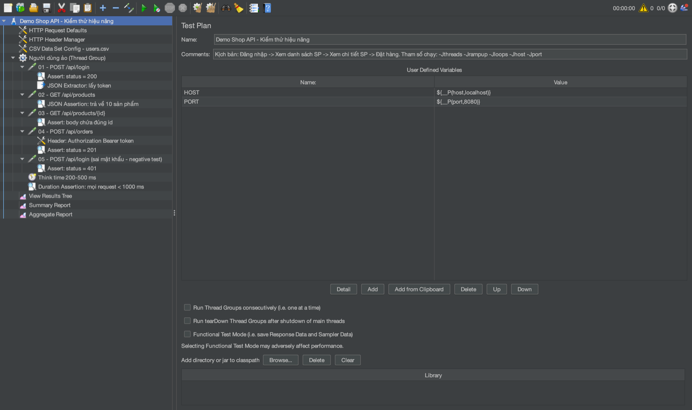

### 5.1. Cấu hình chung

**HTTP Request Defaults**: khai báo một lần giao thức, host, port và timeout cho mọi request:

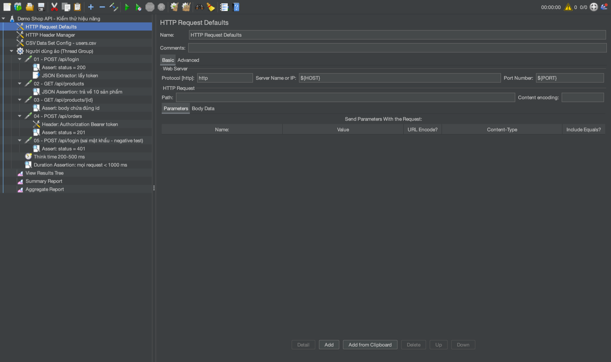

**CSV Data Set Config**: đọc 1000 tài khoản sinh viên từ `data/users.csv` vào biến `${username}`, `${password}`:

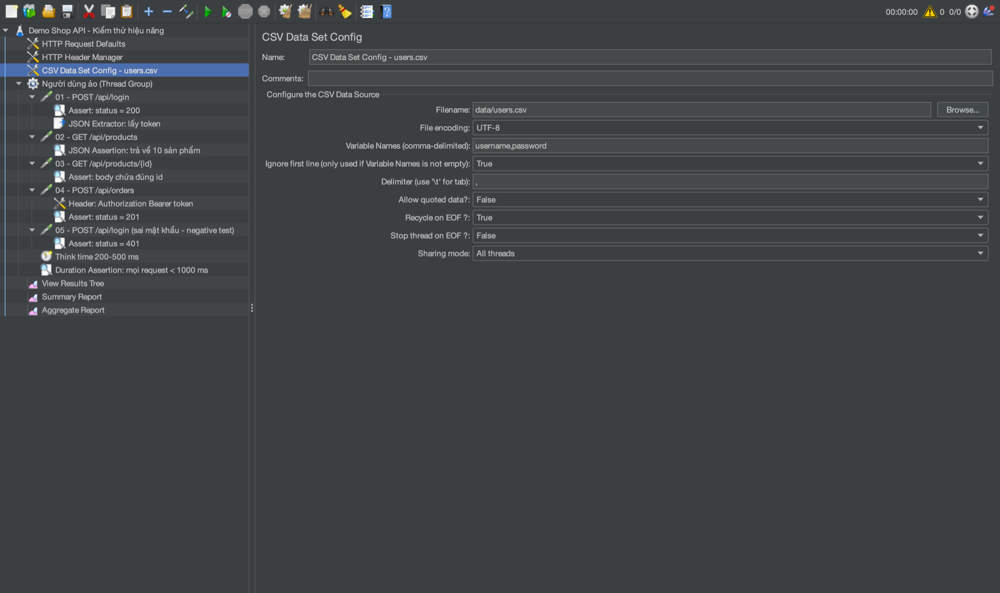

**Thread Group**: số người dùng, ramp-up và số vòng lặp đọc từ tham số dòng lệnh `${__P(threads,20)}`, `${__P(rampup,10)}`, `${__P(loops,10)}`:

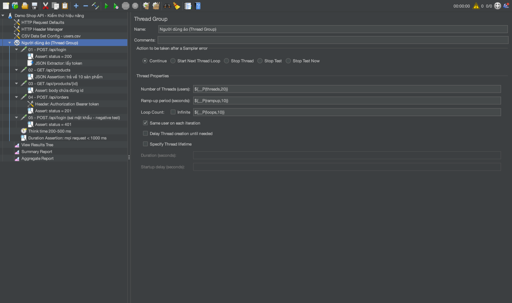

### 5.2. Các request và xử lý kết quả

**01 - POST /api/login**: body JSON dùng biến từ file CSV:

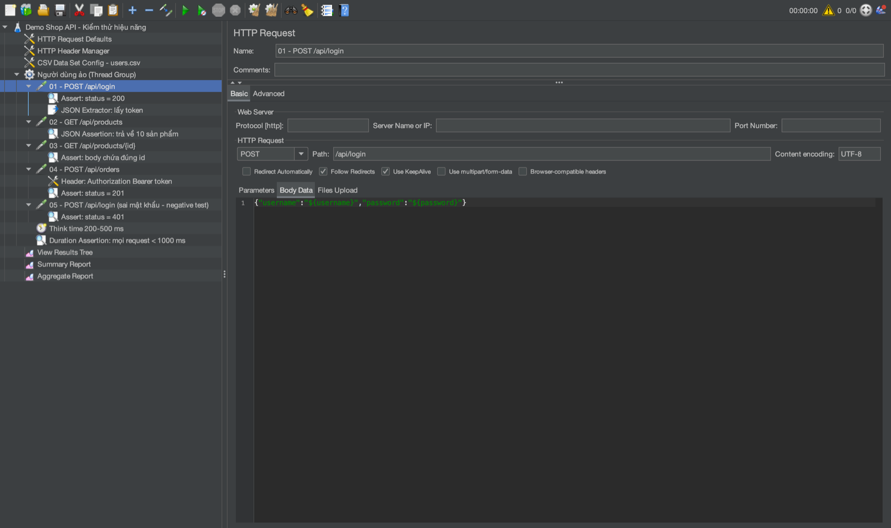

**JSON Extractor**: lấy `token` từ response đăng nhập (`$.token`) để dùng cho các request sau (correlation):

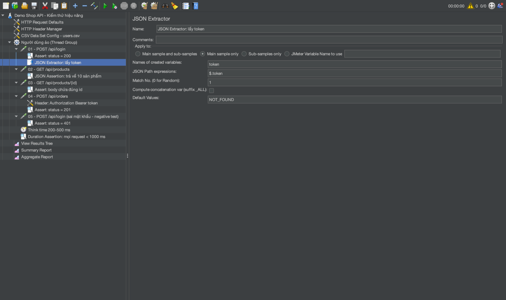

**JSON Assertion**: kiểm tra API danh sách trả về đúng 10 sản phẩm (`$.items.length()` = 10):

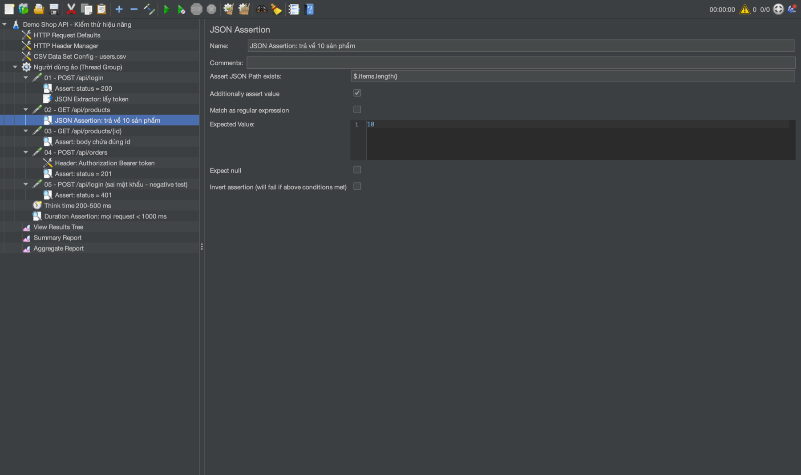

**04 - POST /api/orders**: đặt hàng với `productId` lấy từ request trước:

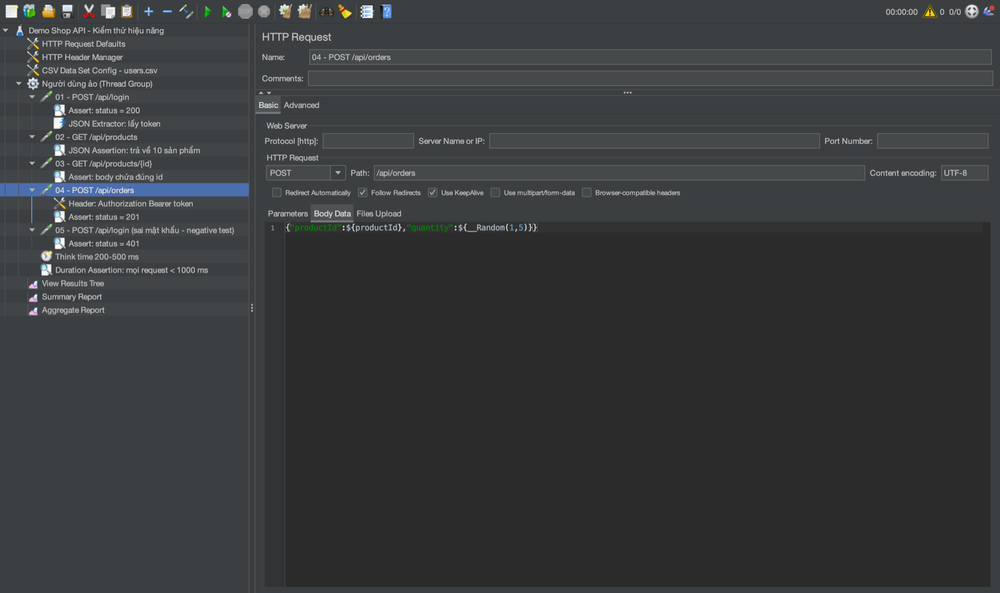

**HTTP Header Manager** riêng của request đặt hàng: gửi `Authorization: Bearer ${token}`:

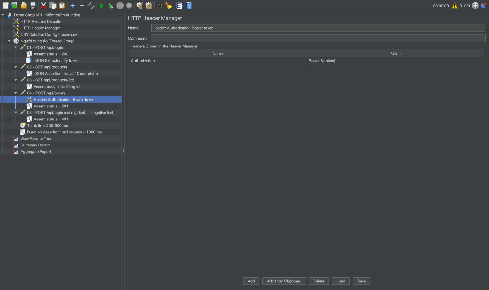

**Duration Assertion**: mọi request phải phản hồi dưới 1000 ms (SLA):

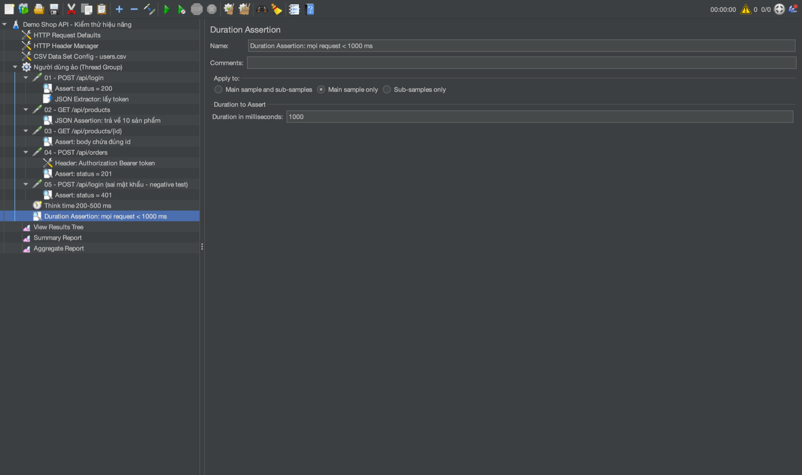

### 5.3. Thông tin thêm

**Luồng nghiệp vụ mô phỏng:** người dùng *đăng nhập → xem danh sách sản phẩm → xem chi tiết → đặt hàng*. Có thêm một **negative test** (đăng nhập sai mật khẩu phải bị từ chối với mã 401).

**Kỹ thuật JMeter đã áp dụng:**
- **Tham số hoá dữ liệu** bằng `CSV Data Set Config` ([`test-plan/data/users.csv`](test-plan/data/users.csv)): file chứa **1000 tài khoản sinh viên** (`sv0001`…`sv1000`), mỗi thread lấy một tài khoản khác nhau.
- **Correlation** (truyền dữ liệu động giữa các request): `JSON Extractor` lấy `token` từ response đăng nhập để dùng ở request đặt hàng.
- **Hàm JMeter**: `${__Random(1,50,productId)}` sinh id ngẫu nhiên và lưu vào biến để dùng lại ở request sau; `${__P(threads,20)}` đọc tham số từ dòng lệnh.
- **Assertions** ở 3 mức: mã trạng thái, nội dung JSON, thời gian phản hồi (SLA < 1 giây).
- **Think time** để mô phỏng thời gian người dùng thật đọc trang.

**Các kịch bản tải** (cùng một file `.jmx`, chỉ đổi tham số):

| Kịch bản | Threads | Ramp-up | Loops | Think time | Tổng request |
|---|---|---|---|---|---|
| Load | 100 | 20 s | 20 | 200–500 ms | 10 000 |
| Stress | 500 | 30 s | 10 | 200–500 ms | 25 000 |
| Spike | 1000 | **2 s** | 3 | 200–500 ms | 15 000 |
| Breakpoint | 4000 | 10 s | 3 | **0 ms** | 60 000 |

## 6. Cách chạy

```bash
# 1. Chạy server (cửa sổ terminal 1)
python3 server/app.py 8080

# 2. Chạy toàn bộ kịch bản (terminal 2). Script tự bật server nếu chưa chạy.
./scripts/run_tests.sh all          # hoặc: load | stress | spike | breakpoint

# 3. Vẽ biểu đồ tổng hợp từ file .jtl (cần matplotlib)
python3 scripts/plot_results.py
```

Lệnh JMeter bên trong script ([`scripts/run_tests.sh`](scripts/run_tests.sh)):

```bash
jmeter -n -t test-plan/DemoShop_LoadTest.jmx \
  -Jthreads=500 -Jrampup=30 -Jloops=10 \
  -l results/stress/results.jtl \
  -Jjmeter.reportgenerator.overall_granularity=1000 \
  -e -o results/stress/report
```

| Tham số | Ý nghĩa |
|---|---|
| `-n` | chế độ non-GUI |
| `-t` | file kịch bản |
| `-J<tên>=<giá trị>` | truyền thuộc tính, đọc trong kịch bản bằng `${__P(tên)}` |
| `-l` | file ghi kết quả thô (.jtl/CSV) |
| `-e -o <thư mục>` | sinh báo cáo HTML Dashboard sau khi chạy |

Kết quả của mỗi kịch bản nằm trong `results/<kịch bản>/`: `results.jtl` (dữ liệu thô), `console.txt` (log), `report/index.html` (**mở bằng trình duyệt để xem dashboard**).

## 7. Kết quả thực hiện

### 7.0. Chạy thử (debug) kịch bản trong GUI

Trước khi chạy tải lớn, kịch bản được chạy thử trong GUI với 10 người dùng × 3 vòng để kiểm tra tính đúng đắn. Tất cả request đều qua (biểu tượng xanh).

**View Results Tree**: xem chi tiết từng request. Ví dụ request `04 - POST /api/orders`:

*Tab Sampler result: mã trạng thái, thời gian, kích thước:*

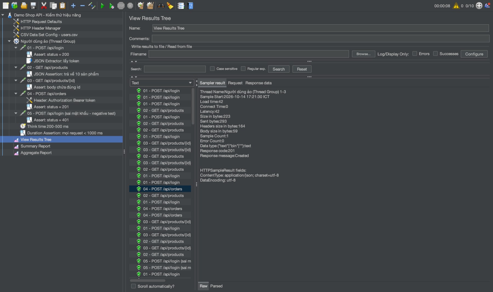

*Tab Request: request thực tế đã gửi tới `POST http://localhost:8080/api/orders`, body chứa `productId` (42) được sinh ở bước xem chi tiết sản phẩm:*

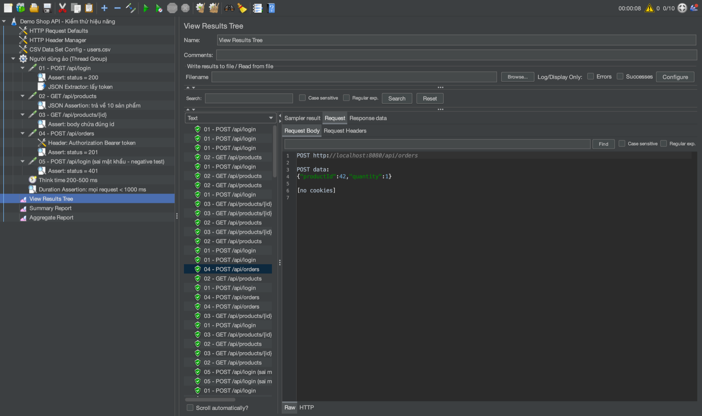

*Tab Response data: server trả về đơn hàng vừa tạo cho sinh viên `sv0003`:*

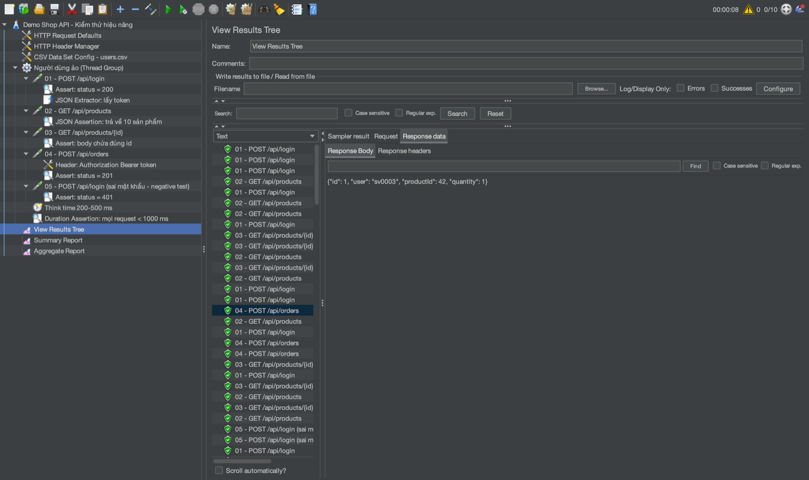

**Summary Report** và **Aggregate Report** của lần chạy thử (150 request, 0% lỗi):

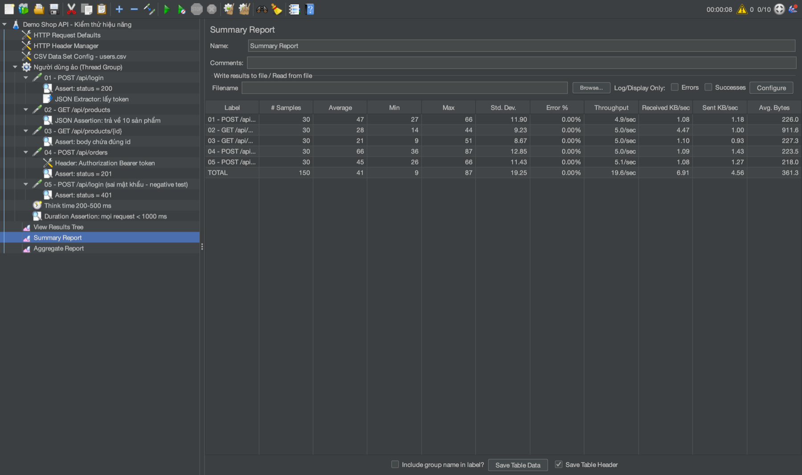
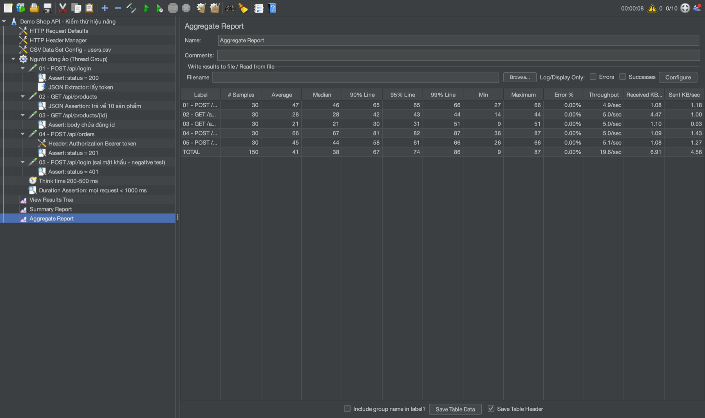

### 7.1. Output khi chạy JMeter ở chế độ dòng lệnh

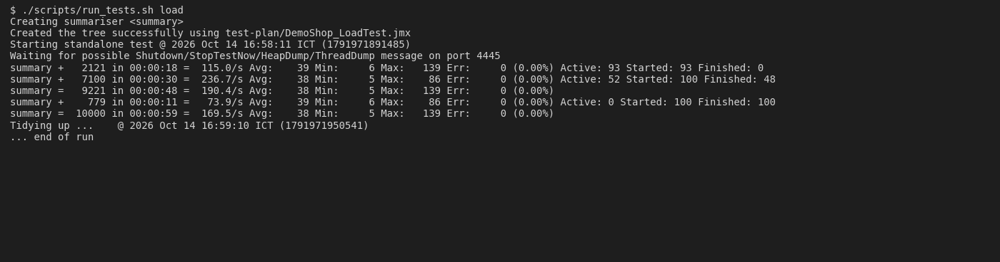

JMeter in ra dòng `summary` mỗi 30 giây: số request, throughput, thời gian trung bình/min/max, số lỗi và số thread đang chạy.

### 7.2. Load test: 100 người dùng

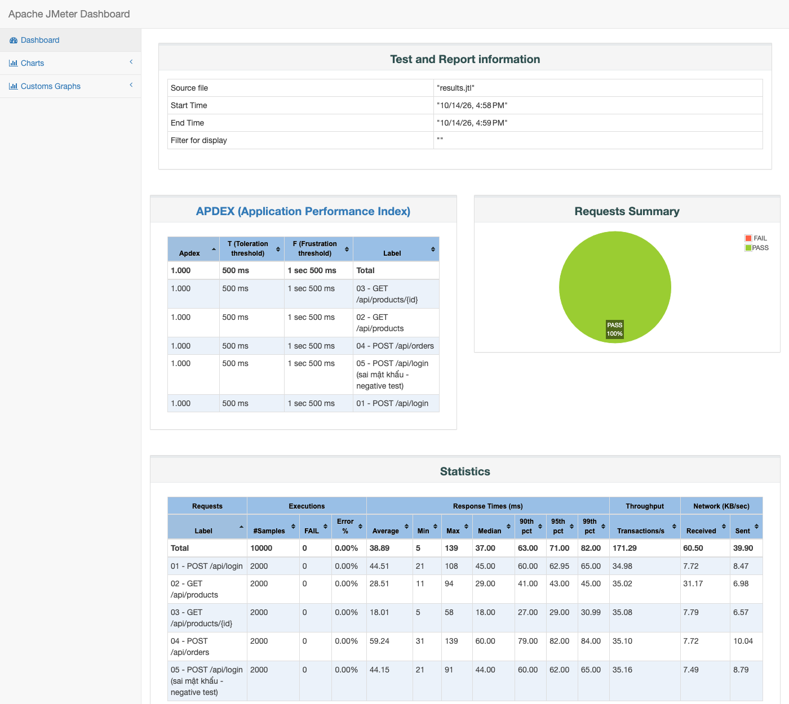
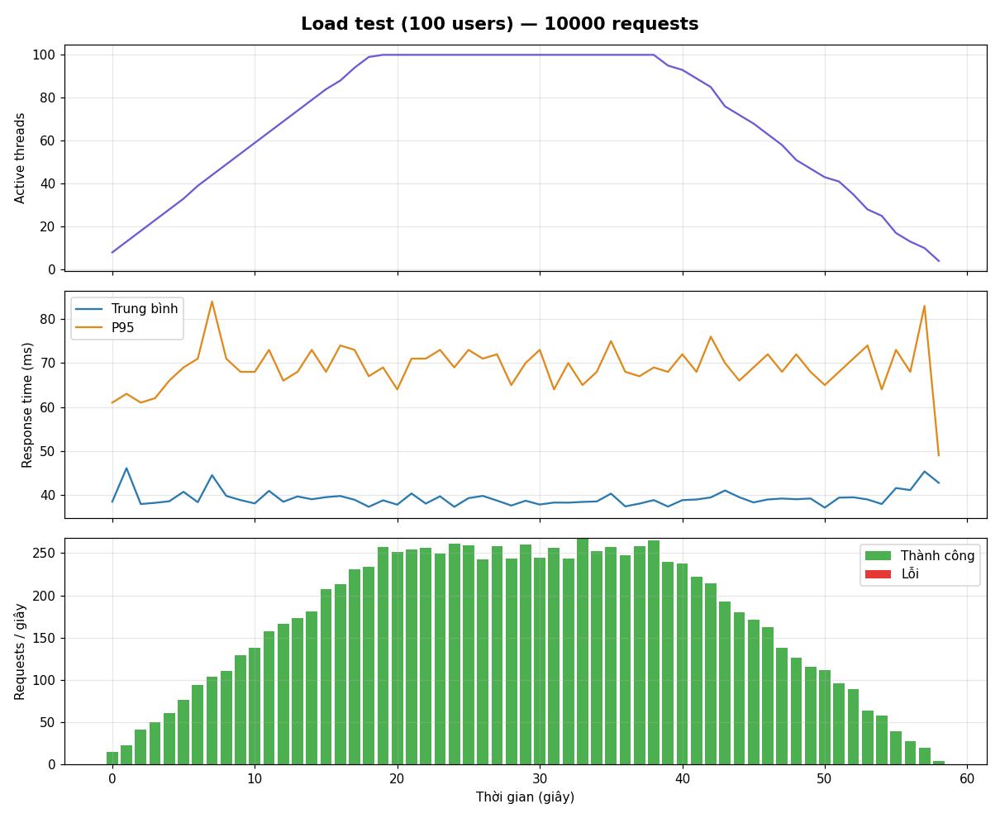

| Request | Samples | Lỗi | Avg (ms) | Median | P90 | P95 | P99 | Max | Throughput (req/s) |
|---|---|---|---|---|---|---|---|---|---|
| 01 - POST /api/login | 2 000 | 0.00% | 45 | 45 | 60 | 63 | 65 | 108 | 35.0 |
| 02 - GET /api/products | 2 000 | 0.00% | 29 | 29 | 41 | 43 | 45 | 94 | 35.0 |
| 03 - GET /api/products/{id} | 2 000 | 0.00% | 18 | 18 | 27 | 29 | 31 | 58 | 35.1 |
| 04 - POST /api/orders | 2 000 | 0.00% | 59 | 60 | 79 | 82 | 84 | 139 | 35.1 |
| 05 - POST /api/login (sai MK) | 2 000 | 0.00% | 44 | 44 | 60 | 62 | 65 | 91 | 35.2 |
| **Tổng** | **10 000** | **0.00%** | **39** | **37** | **63** | **71** | **82** | **139** | **171.3** |

### 7.3. Stress test: 500 người dùng


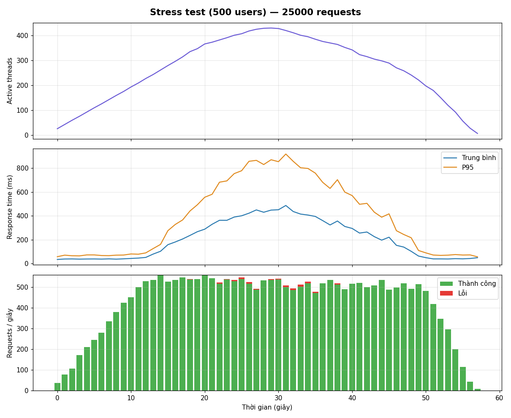
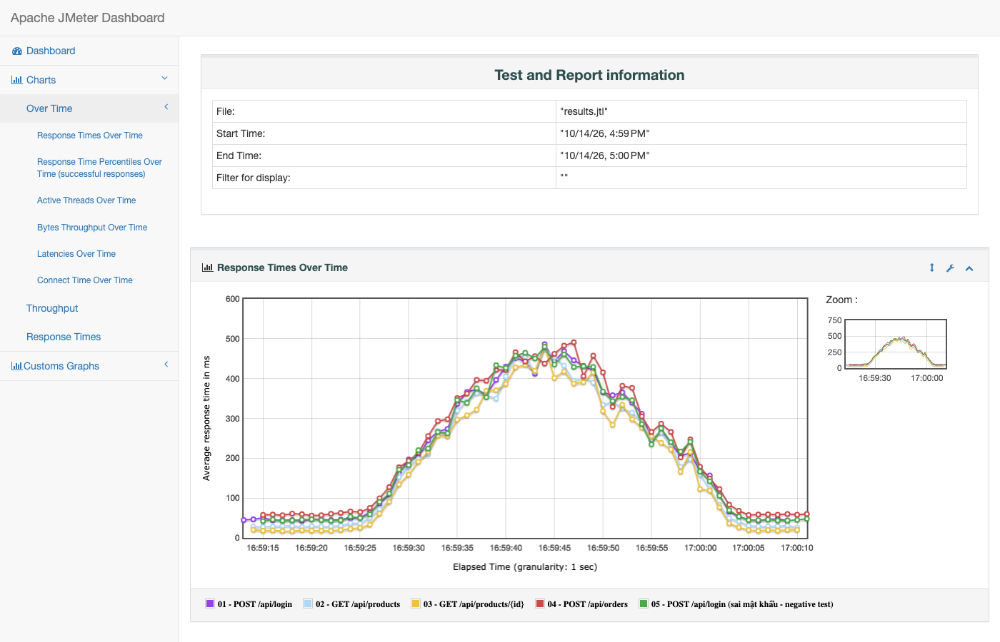

| Request | Samples | Lỗi | Avg (ms) | Median | P90 | P95 | P99 | Max | Throughput (req/s) |
|---|---|---|---|---|---|---|---|---|---|
| 01 - POST /api/login | 5 000 | 0.60% | 244 | 220 | 463 | 590 | 900 | 1 710 | 89.1 |
| 02 - GET /api/products | 5 000 | 0.48% | 229 | 204 | 444 | 529 | 874 | 1 439 | 89.0 |
| 03 - GET /api/products/{id} | 5 000 | 0.32% | 217 | 189 | 436 | 520 | 850 | 1 806 | 88.9 |
| 04 - POST /api/orders | 5 000 | 0.58% | 259 | 235 | 477 | 570 | 890 | 2 033 | 88.8 |
| 05 - POST /api/login (sai MK) | 5 000 | 0.00% | 246 | 220 | 465 | 595 | 886 | 1 357 | 88.9 |
| **Tổng** | **25 000** | **0.40%** | **239** | **282** | **472** | **660** | **901** | **2 033** | **432.4** |

Toàn bộ 99 lỗi đều là **Duration Assertion**: server vẫn trả về đúng (200/201) nhưng chậm hơn 1 giây.

### 7.4. Spike test: 1000 người dùng vào trong 2 giây

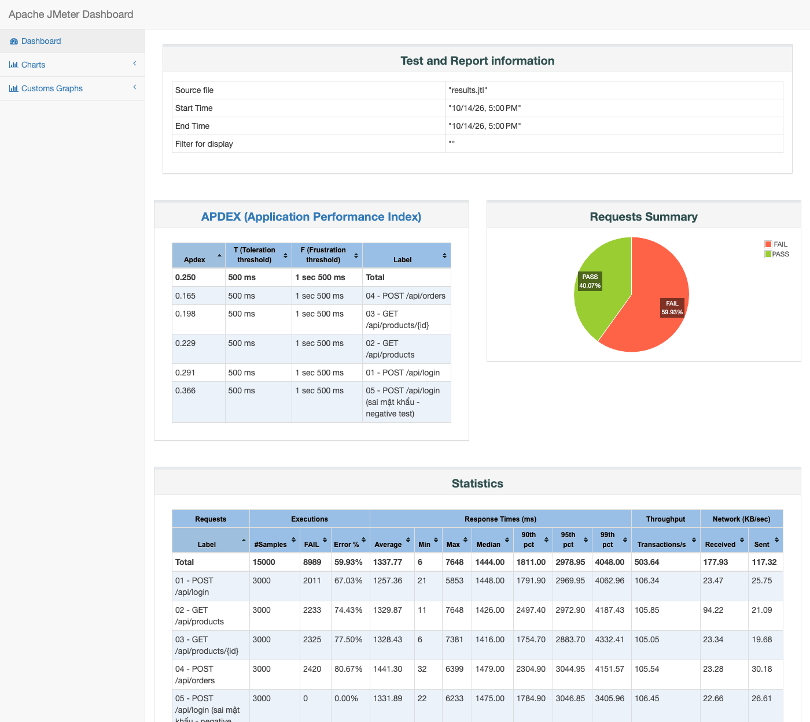
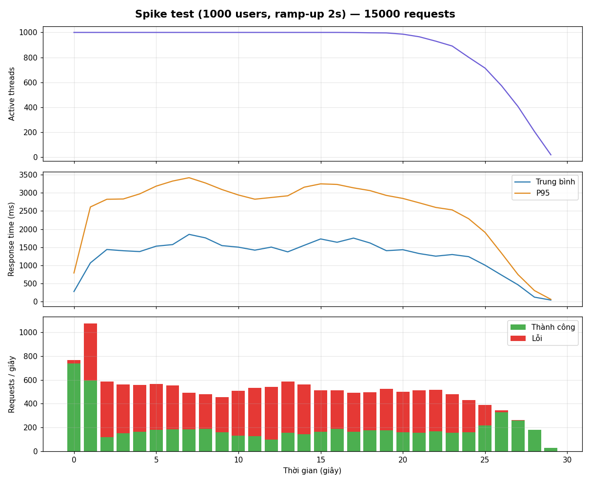
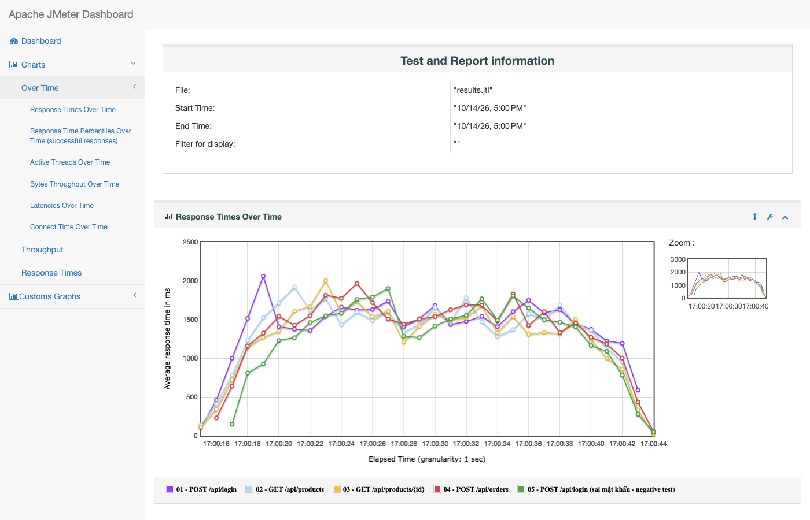

| Request | Samples | Lỗi | Avg (ms) | Median | P90 | P95 | P99 | Max | Throughput (req/s) |
|---|---|---|---|---|---|---|---|---|---|
| 01 - POST /api/login | 3 000 | 67.03% | 1 257 | 1 448 | 1 792 | 2 970 | 4 063 | 5 853 | 106.3 |
| 02 - GET /api/products | 3 000 | 74.43% | 1 330 | 1 426 | 2 497 | 2 973 | 4 187 | 7 648 | 105.8 |
| 03 - GET /api/products/{id} | 3 000 | 77.50% | 1 328 | 1 416 | 1 755 | 2 884 | 4 332 | 7 381 | 105.0 |
| 04 - POST /api/orders | 3 000 | 80.67% | 1 441 | 1 479 | 2 305 | 3 045 | 4 152 | 6 399 | 105.5 |
| 05 - POST /api/login (sai MK) | 3 000 | 0.00% | 1 332 | 1 475 | 1 785 | 3 047 | 3 406 | 6 233 | 106.4 |
| **Tổng** | **15 000** | **59.93%** | **1 338** | **1 444** | **1 811** | **2 979** | **4 048** | **7 648** | **503.6** |

Toàn bộ 8 989 lỗi đều là **Duration Assertion** (phản hồi đúng nhưng > 1 giây). Không có lỗi kết nối: server không "sập" mà chỉ trả lời rất chậm.

### 7.5. Breakpoint test: 4000 người dùng, không có think time

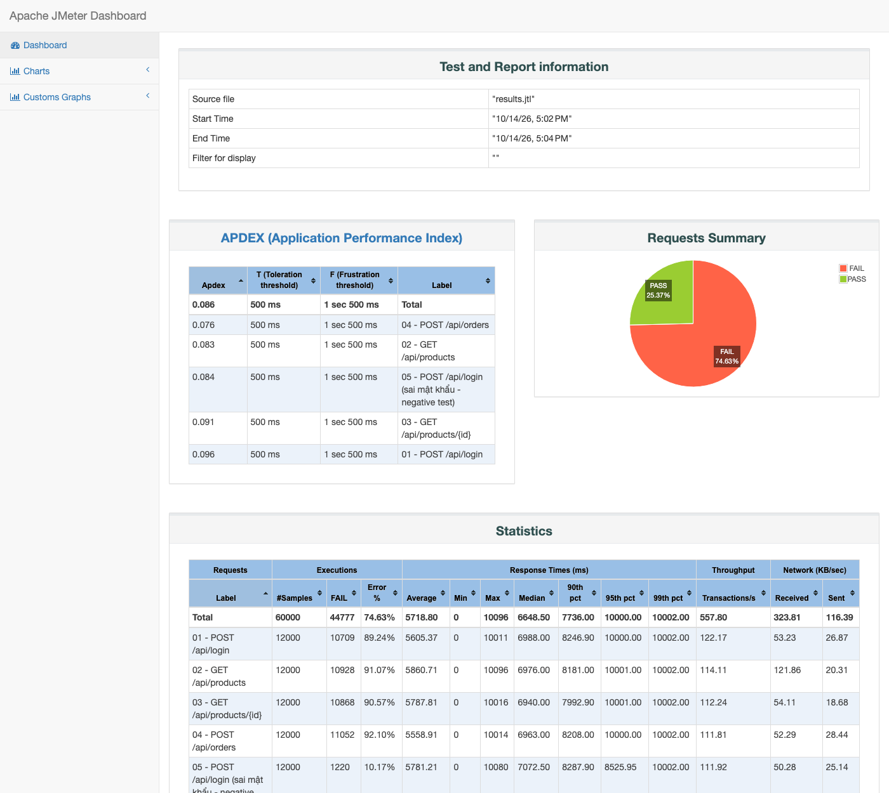
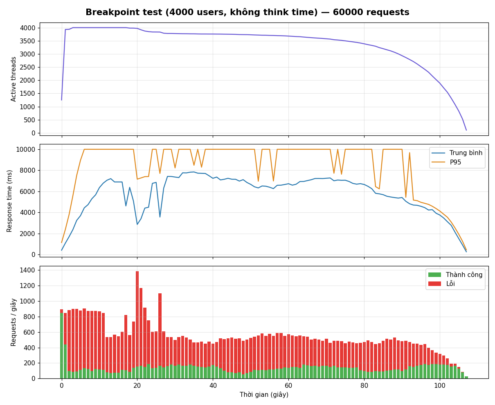
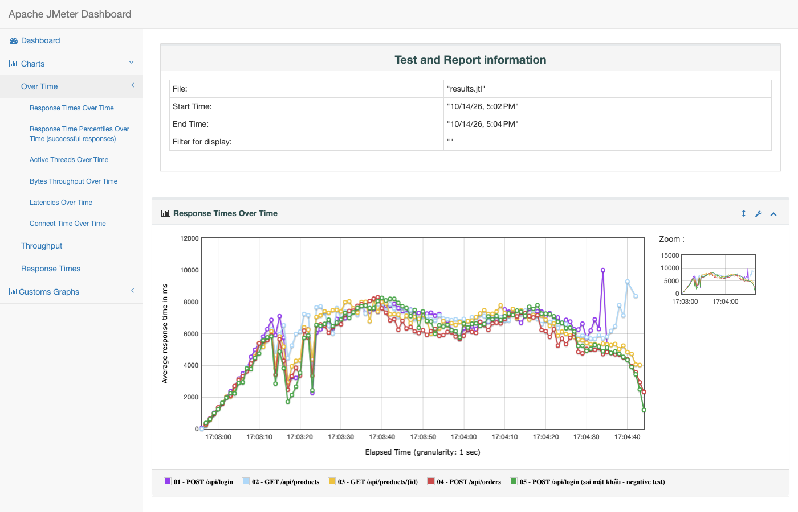

| Request | Samples | Lỗi | Avg (ms) | Median | P90 | P95 | P99 | Max | Throughput (req/s) |
|---|---|---|---|---|---|---|---|---|---|
| 01 - POST /api/login | 12 000 | 89.24% | 5 605 | 6 988 | 8 247 | 10 000 | 10 002 | 10 011 | 122.2 |
| 02 - GET /api/products | 12 000 | 91.07% | 5 861 | 6 976 | 8 181 | 10 001 | 10 002 | 10 096 | 114.1 |
| 03 - GET /api/products/{id} | 12 000 | 90.57% | 5 788 | 6 940 | 7 993 | 10 001 | 10 002 | 10 016 | 112.2 |
| 04 - POST /api/orders | 12 000 | 92.10% | 5 559 | 6 963 | 8 208 | 10 000 | 10 002 | 10 014 | 111.8 |
| 05 - POST /api/login (sai MK) | 12 000 | 10.17% | 5 781 | 7 072 | 8 288 | 8 526 | 10 002 | 10 080 | 111.9 |
| **Tổng** | **60 000** | **74.63%** | **5 719** | **6 648** | **7 736** | **10 000** | **10 002** | **10 096** | **557.8** |

Phân loại lỗi (bảng *Errors* trong dashboard):

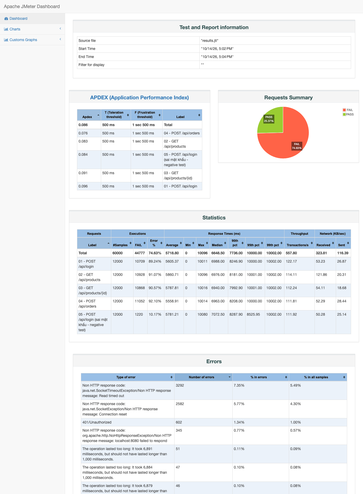

| Loại lỗi | Số lượng | Giải thích |
|---|---|---|
| Duration Assertion (status 200/201 nhưng > 1000 ms) | 37 956 | Server vẫn trả kết quả đúng nhưng quá chậm, vi phạm SLA |
| `java.net.SocketTimeoutException` | 3 292 | Chờ quá 10 s (response timeout) không có phản hồi |
| `java.net.SocketException: Connection reset` | 2 582 | Server/hệ điều hành cắt kết nối do quá nhiều kết nối đồng thời |
| 401 ở bước đặt hàng | 602 | **Lỗi dây chuyền**: đăng nhập thất bại nên không có token, request đặt hàng bị từ chối |
| `NoHttpResponseException` | 345 | Kết nối bị đóng trước khi server kịp trả lời |
| **Tổng** | **44 777** | |

## 8. Phân tích và đánh giá

**Tổng hợp 4 kịch bản:**

| Kịch bản | Users | Throughput | Avg | P95 | Lỗi | Đánh giá |
|---|---|---|---|---|---|---|
| Load | 100 | 171 req/s | 39 ms | 71 ms | 0% | Đạt |
| Stress | 500 | 432 req/s | 239 ms | 660 ms | 0.40% | Đạt, nhưng chậm gấp ~6 lần |
| Spike | 1000 (2 s) | 504 req/s | 1 338 ms | 2 979 ms | 59.93% | Không đạt SLA |
| Breakpoint | 4000 | **558 req/s** (bão hoà) | 5 719 ms | 10 000 ms | 74.63% | **Quá tải** |

**Nhận xét:**

1. **Tải bình thường (100 users)**: thời gian phản hồi ổn định ~39 ms (P95 = 71 ms), 0% lỗi. Hệ thống còn dư năng lực.
2. **Stress test (500 users)**: throughput tăng lên 432 req/s, gần mức tối đa. Thời gian trung bình tăng **gấp ~6 lần** (39 → 239 ms), P99 lên 901 ms và 0.4% request vượt 1 giây. Hệ thống bắt đầu có hàng đợi nhưng vẫn ổn.
3. **Spike test (1000 users trong 2 giây)**: hệ thống **không chịu được** đợt tăng đột ngột. Thời gian trung bình 1.3 s, 60% request vi phạm SLA 1 giây. Tuy vậy không có lỗi kết nối nào: server không sập mà phục vụ chậm.
4. **Breakpoint test (4000 users)**: throughput **không tăng thêm mà dừng ở ~530–560 req/s** dù số người dùng tăng gấp 8 lần so với stress. Thời gian phản hồi ~5.7 s, nhiều request timeout 10 s và bắt đầu bị cắt kết nối (`Connection reset`). Đây là **giới hạn chịu tải** của hệ thống.
5. **Xác định nút cổ chai:** throughput tối đa ~530 req/s khớp với tính toán lý thuyết của connection pool: `20 kết nối ÷ ~0.038 s/truy vấn ≈ 525 truy vấn/giây`. CPU và mạng không phải nguyên nhân. Vậy **nút cổ chai là connection pool CSDL**. Muốn tăng năng lực cần tăng kích thước pool, tối ưu truy vấn, hoặc thêm cache cho các API đọc (`GET /api/products`).
6. **Lỗi dây chuyền:** trong breakpoint test, khi `login` thất bại thì `orders` cũng thất bại (401) do thiếu token. Khi đọc báo cáo cần tìm **lỗi gốc** chứ không chỉ đếm số lỗi.

**Những điều rút ra khi làm bài (bài học thực tế):**
- **Lần chạy đầu tiên của stress test có 2.85% lỗi `Connection refused`**, toàn bộ nằm trong 12 giây đầu. Nguyên nhân là JMeter bắt đầu gửi request khi server chưa sẵn sàng, **không phải do server quá tải**. Đã sửa script để chờ `/api/health` trả về OK rồi mới chạy test. Bài học: cần kiểm tra môi trường trước khi chạy, và đọc biểu đồ theo thời gian thay vì chỉ nhìn con số tổng.
- **Báo cáo HTML mặc định gộp dữ liệu theo từng phút**, nên với bài test ngắn, biểu đồ "Over Time" chỉ có 1 điểm. Cần thêm `-Jjmeter.reportgenerator.overall_granularity=1000` để gộp theo từng giây.
- **Giới hạn số thread của hệ điều hành:** lần đầu chạy breakpoint với 5000 users, JMeter chỉ khởi tạo được **4061 thread** rồi dừng, chỉ ghi được 58 349/75 000 request. Nguyên nhân là macOS giới hạn tối đa **4096 thread cho mỗi tiến trình** (`sysctl kern.num_taskthreads`), và JMeter cũng cần một số thread cho chính nó. Đã giảm xuống 4000 users để chạy trọn vẹn. Muốn mô phỏng nhiều người dùng hơn cần dùng **JMeter phân tán** (nhiều máy sinh tải, chế độ master/slave) hoặc tăng heap (`HEAP="-Xms1g -Xmx4g"`).
- **Lần đầu server chỉ "ngủ" để giả lập truy vấn nên chịu được tới 6 700 req/s, không bao giờ lỗi.** Điều này không thực tế. Sau khi thêm giới hạn connection pool, kết quả mới phản ánh đúng hành vi của hệ thống thật.
- **"Ignore Status" của Response Assertion xoá luôn lỗi của các assertion khác.** Request negative test (05) có thời gian trung bình 5.8 s ở breakpoint test nhưng chỉ báo 10% lỗi (spike: 1.3 s nhưng 0% lỗi), vì tuỳ chọn *Ignore Status* đặt lại trạng thái thành công, ghi đè cả kết quả của Duration Assertion. Cần lưu ý khi kết hợp các assertion.
- **Chạy JMeter và server trên cùng một máy** làm hai bên tranh tài nguyên. Kiểm thử thực tế nên đặt máy sinh tải tách biệt với server.

## 9. Kết luận

- Đã tìm hiểu kiến trúc và các thành phần chính của JMeter: Thread Group, Sampler, Config Element, Post-Processor, Assertion, Timer, Listener.
- Đã xây dựng kịch bản kiểm thử REST API hoàn chỉnh, có **tham số hoá dữ liệu (CSV)**, **correlation (JSON Extractor)**, **assertions** và **think time**.
- Đã chạy 4 loại kiểm thử hiệu năng (load, stress, spike, breakpoint) ở chế độ non-GUI và sinh báo cáo HTML Dashboard.
- Đã mô phỏng tới **4000 người dùng đồng thời** với **1000 tài khoản sinh viên**, xác định được **giới hạn của hệ thống ≈ 530–560 req/s** và **nút cổ chai là connection pool CSDL**, kèm đề xuất cải thiện.

## 10. Tài liệu tham khảo

1. Apache JMeter User Manual: https://jmeter.apache.org/usermanual/index.html
2. JMeter: Getting Started: https://jmeter.apache.org/usermanual/get-started.html
3. JMeter: Component Reference: https://jmeter.apache.org/usermanual/component_reference.html
4. JMeter: Generating Dashboard Report: https://jmeter.apache.org/usermanual/generating-dashboard.html
5. JMeter: Functions and Variables: https://jmeter.apache.org/usermanual/functions.html
6. BlazeMeter Blog, JMeter tutorials: https://www.blazemeter.com/blog

---

### Cấu trúc thư mục

```
.
├── README.md                     # Báo cáo (file này)
├── server/app.py                 # Demo Shop API (đối tượng kiểm thử)
├── test-plan/
│   ├── DemoShop_LoadTest.jmx     # Kịch bản JMeter
│   └── data/users.csv            # Dữ liệu tài khoản
├── scripts/
│   ├── run_tests.sh              # Chạy các kịch bản + sinh HTML report
│   └── plot_results.py           # Vẽ biểu đồ từ .jtl
├── results/<kịch bản>/           # results.jtl, console.txt, report/index.html
└── images/                       # Hình minh hoạ trong báo cáo
```
